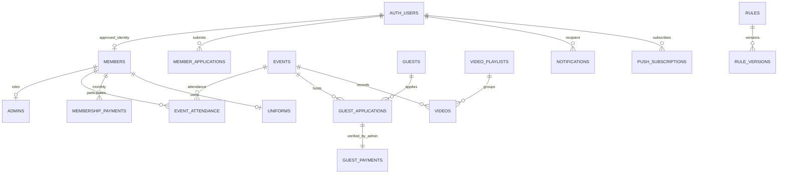

# SpotLight architecture

Next.js App Router / React / TypeScript mobile PWA → same-origin Route Handlers → Supabase Auth + PostgreSQL (RLS) + private Storage. Supabase SSR sessions use PKCE and verified getUser(), not a client-selected role. MongoDB health endpoint remains a legacy diagnostic; club data uses PostgreSQL.

## Entity relationships

## Permissions

| Data/action                             | Guest       | Pending Google user | Active Member   | Admin               |
| --------------------------------------- | ----------- | ------------------- | --------------- | ------------------- |
| Published public events, notices, rules | read        | read                | read            | manage              |
| Guest form                              | submit only | submit only         | submit only     | manage              |
| Membership application                  | login first | own submit/read     | own read        | review              |
| Profile/attendance/dues/uniform         | no          | no                  | own only        | manage              |
| Paid guest count / RSVP count           | no          | no                  | aggregate only  | aggregate + details |
| Guest identities / admin notes          | no          | no                  | no              | read/manage         |
| Videos                                  | public only | public only         | member + public | manage              |
| Export/Import/roles                     | no          | no                  | no              | manage              |
| Notification inbox                      | no          | own                 | own             | own                 |

RLS uses DB-managed membership and admin rows. No self-service updates to role, membership state, join date, payments or actual attendance. Sensitive commands use narrow transactional RPCs. Service-role access is restricted to guest submission, scheduled delivery and initial manual bootstrap. All normal authenticated API queries use the caller's JWT and RLS.

## Authentication

Google button → Supabase OAuth/PKCE → /auth/callback exchange → verified auth user → members.user_id → active membership → admins membership lookup. No email-only auto-link. Imported members are linked only by admin after matching an authenticated application with phone/name; user ID is immutable to members. First admin is assigned manually using the SQL bootstrap script after Google login. No publicly callable bootstrap API.

## Screens/navigation

Guest: Home / Calendar / Notices / My account. Event detail → five-step guest application → bank details → receipt (no searchable public guest list).
Member: Home / Calendar / Videos / My account (profile, attendance, dues, rules, uniform). Admin: Home / Guests / Members / Calendar / More (attendance, dues, notices, videos, analytics, import/export, rules, uniforms, settings). App bar and safe-area bottom bar; cards, chips, dialogs and 44px controls. A separate explicit /preview route uses fictional fixtures only, never creates an authenticated role.

## Guest intake extensions (007)

Normalized phone is the stable Guest key; per-event GuestApplication stores submitted personal answers and independent GuestPayment. Anonymous submission cannot rename the shared Guest record and the receipt contains only the new application/event/payment, never that phone's history. The service-only `submit_guest_receipt` wraps the existing UUID-returning transaction, preserving its identity, rate limit, unique guest/event constraint, notifications and consent checks. No public receipt-lookup endpoint, account, capacity, waitlist or onsite payment is introduced.

FormQuestions includes versioned system-field labels/help and editable custom questions. Immutable keys preserve answer mapping. Custom deletion archives the definition; required system structure is protected. A database trigger stores question definitions on each application and validates the submitted complete questionnaire version and required/select extra answers. Existing legacy imports without questionnaire versions remain supported; historical versions are not invented. Current public intake requires notice, rule, photo and privacy confirmations, records notice/rule versions and server privacy context, and forces re-consent when the visible questionnaire/notices change.

The completion view uses the transactional payment amount/status and server bank/depositor instructions. Self-reported payment never counts as paid. Repeated admin payment confirmation preserves its first verifier/timestamp. Guest visit statistics derive from admin-confirmed actual attendance after a paid event ends; future payments and unverified historical attendance count as zero visits. `admin_guest_history` returns bounded recent history and aggregate visits only after rechecking the active admin role. Guest/member API and RLS restrictions remain unchanged.

## Member extensions (008)

Membership applications retain their original answers and existing approval transaction. Current web intake adds explicit current-month guest participation and preserves self-reported fee payment separately from verified dues. Review notes/timestamps are visible to the applicant, while hold/reject never grants an active member role. Existing admin title arrays support multiple operational roles on the same personal profile.

MemberNameRequests stores the old/requested name, reason and review decision. Requests are read only by their member/admin; narrow RPCs create/review them with member-row locking and stale-name detection. `update_my_profile` no longer accepts a changed name. Admin direct corrections remain available. No attendance, dues, uniform or RSVP relation is re-keyed: member UUIDs remain stable.

Photo upload validates the type/size, stores an owned private object, immediately attaches it through `set_my_avatar`, removes the new object if attachment fails and attempts replacement cleanup. Old profile forms cannot restore arbitrary/deleted photos. Photos remain private and use short-lived signed URLs. The `my_activity_summary` RPC binds to the current member, calculates KST year/month actual attendance without the history screen's 500-row cap, excludes future/cancelled/deleted events and returns only that member's current-month dues. Name/photo/profile/summary operations cannot target another member.

Future directory opt-ins live in a separate RLS-protected MemberDirectoryPreferences table (name/photo/position flags all false). No broader member SELECT policy or public directory endpoint is added. Any future directory must explicitly project allowed fields and design opted-in photo access; current avatar policies still restrict reads to the owner/admin.

## Operations extensions (009)

Existing IDs/tables/RLS are preserved. RSVP supports yes/no/unanswered through both HTTP and PostgreSQL, and never sets actual attendance. Actual confirmation requires an admin after the event ends and records checked_at/by independently of RSVP. Holiday/cancelled/deleted/future events cannot be confirmed. Shared private summaries count only valid actual attendance by KST event-start date. Owner-bound and admin-only report RPCs provide exact twelve-month counts and paginated records; the admin event roster also paginates and retains inactive historical attendees.

The admin dashboard returns a consistent selected-event snapshot: member yes count, guest application/paid/pending counts, paid-only expected total and that event's unanswered task count. It handles multiple workouts and no-workout days, plus global pending work and latest-five applications. Member endpoints retain their explicit aggregate-only projection and cannot invoke admin dashboard/report/dues/member-summary RPCs. Admin member details use the same exact attendance logic and current-month dues. Dues summaries distinguish registered unpaid records from missing records; the current-month unpaid shortcut clears stale month/member filters. No payment states or relationships are replaced.

Existing GitHub main → Vercel community-web hosting was verified on 2026-11-02. The configured production domain is https://community-web-yoonseol.vercel.app and redirects unauthenticated visitors to Vercel Authentication. A local server stopping does not imply Internet loss; the offline page now says so on localhost. The service worker still caches only public offline assets and clears only its own stale cache namespace.

## Notifications / deployment

Transactional DB triggers create recipient-specific inbox entries and outbox records. Only admins get applications/13:00 roster; emergency notices go to active members. Cron 04:00 UTC = 13:00 KST. Uniqueness on event/recipient/kind prevents duplicate daily rosters. Web Push outbox retries are bounded; expired subscriptions removed. Service worker never caches API, authenticated HTML or private media. Vercel HTTPS hosting, Supabase managed DB/Auth/Storage, environment secrets. Production cannot accept public applications until configured; no mock success.

## Migration

See MIGRATION.md. Raw sheets are read-only references. Original answers retained as JSON. Ambiguous identities and inconsistent dates block import rows. Preview is bound to a server-stored batch and content digest; commit is transactional and idempotent. Actual personal rows are never committed to Git. Development fixtures require a dedicated local project and do not run during build/deploy.
